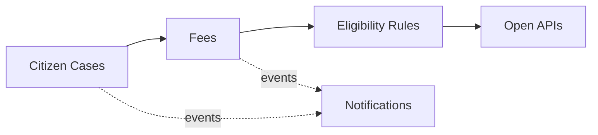

# Domain Model and Bounded Contexts

Ubiquitous language and context design (view VP-4). Domain-standard concepts are mapped
normatively in `../domain/domain-standards.md` (CR-5).

## Ubiquitous language (selected terms)

| Term | Meaning |
|---|---|
| **Citizen case** | A permit, license, benefit or complaint case; its reference code is masked |
| **Fee account** | A case's assessed-fee account, drawn down by payments |
| **Fee payment** | One payment against an assessed fee (online, bank, office) |
| **Eligibility rule** | A decision rule binding a program type to benefit and processing envelopes |
| **Agency** | A federal, state or municipal body in the catalogue |
| **Case risk score** | A transparent 0-100 score for delay and documentation risk |

## Bounded contexts and invariants

### Citizen Cases — `case-service`
Citizen case registry; the reference code (folio) is masked at intake. Lifecycle: `OPEN` → transitions
assign, resolve. Case reference codes are validated at intake and never stored or returned in clear — only a masked form is kept. Citizen personal data is minimized; all data here is synthetic.

### Fees — `fee-service`
Assessed-fee accounts per case and the payments applied to them. **Invariant (ADR-0004): payments applied to a public case never exceed its assessed fee — a payment that would overpay is rejected (422) and records nothing; public money movements are always fully evidenced.** Consumption records are
append-only evidence; a rejected operation records nothing.

### Eligibility Rules — `eligibility-rules-service`
Decision rules binding program types to benefit caps and processing envelopes. Only ACTIVE rules decide; evaluation order is by priority; every decision
is ALLOWED / DEGRADED / DENIED with the matched rule and a human-readable reason.

### Agencies — `agency-catalog-service`
Catalogue of public agencies and their service counts.

### Notifications — `notification-service`
Delivery trail for audit; recipients are never logged.

## Context map

