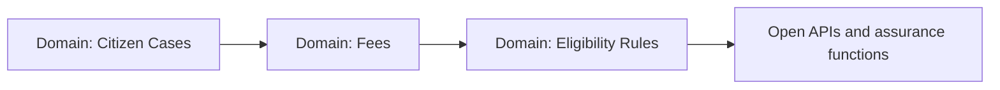

# Implementation Roadmap — Sequence

Decision recorded 2026-11-03 (repository owner), mirroring the sequencing used for the
other Open Industries reference cores: foundations first, the invariant path next,
decisioning and open APIs last.

## Step 1 — Citizen Cases (pilot) and the platform documentation

- Architecture definition + full standards documentation set (this repository's `docs/`).
- `case-service` as the executable pilot.
- Exit criteria: `mvn verify` green; privacy behavior demonstrated by tests.

## Step 2 — Fees (the invariant path)

- Guarded accounts and consumption records. Exit criteria: the domain invariant
  (payments applied to a public case never exceed its assessed fee — a payment that would overpay is rejected (422) and records nothing; public money movements are always fully evidenced.) demonstrated by tests — over-draw rejected, state unchanged.

## Step 3 — Eligibility Rules + Agencies

- Rules with reasoned decisions; the secondary registry. Exit criteria: DENIED baseline
  and ALLOWED path demonstrated by tests.

## Step 4 — Open APIs and assurance functions

- Exposure hardening, the scorer and evaluator functions closing the assurance loop.
- Exit criteria: contract diff clean; SLO evidence produced.

Everything is *aligned to* the cited standards; nothing is a certification or a claim of
regulatory compliance, and all data is synthetic. **No pull request is merged without the
repository owner's explicit approval.**
